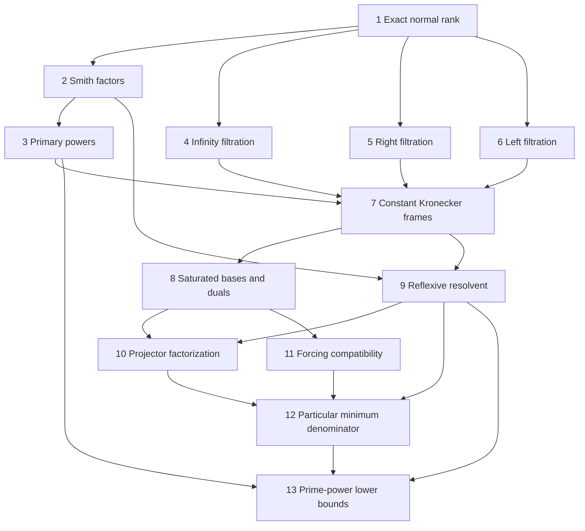

# Dependency map

The longest displayed scientific dependency path contains eight nodes. Some oracle computations can run in parallel or bypass a displayed constructive route; the contract requires valid connected certificates rather than a specific execution sequence. Constant frames validate the full classification independently, while projectors connect the chosen (possibly different) bases to the chosen inverse. The lower-bound rows may also be independently constructed rather than extracted from that inverse.
